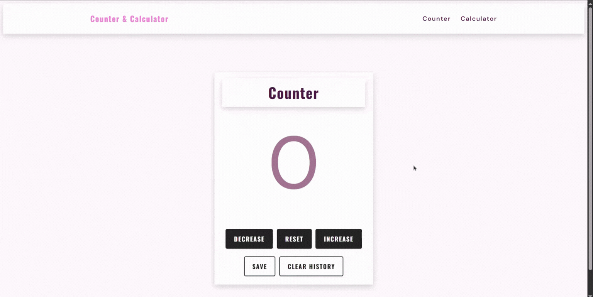
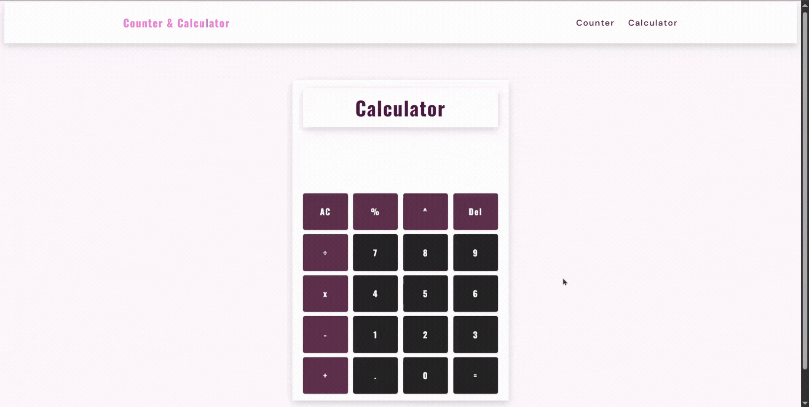

Used HTML, CSS, and vanilla JavaScript to create function counter and calculator web apps. 

Counter app includes a "Save" feature which stores and displays the most recent total. 
Allows you to save multiple recent totals and notifies you when the maximum number of saves has been reached.

Calculator features all standard arithmetic operators.

